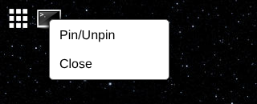

# Context Menus

Right-clicking some parts of the desktop shows a menu. Each menu is an XML file in [`system/components/context menus/`](../siteroot/system/components/context%20menus/):

| Right-click on | File | Items |
| --- | --- | --- |
| A taskbar icon | `taskbarItem.xml` | **Pin/Unpin**, **Close** |
| An app in the home menu | `appItem.xml` | **Remove**, **Delete App** |
| A panel's title bar | `panelTitleBar.xml` | **close** (panels are disabled; see [Panels](Panels.md)) |



Only **Close** works. The other items call `System` functions that don't exist yet (see [System Object](System-Object.md)), so clicking them throws an error and nothing happens. Right-clicking anywhere else shows the browser's normal menu.

## File format

```
<?xml version="1.0" encoding="utf-8" ?>

<contextmenu>
	<item value="Close">
		System.closeWindow(System.selected.parentNode.getAttribute('data-appID'));
	</item>
</contextmenu>
```

Each `<item>`'s `value` is the label, and its text is JavaScript that runs on the desktop page when the item is clicked. `System.selected` is the element that was right-clicked (for a taskbar icon, the ``; its parent holds the window's AppID in `data-appID`). Because the code is placed inside an HTML `onclick` attribute, it must not contain double quotes.

Which file is used for which element is decided in `handleContextmenuEvent` in [`index.html`](../siteroot/index.html); apps can't add their own menus.

---

_New page, written from the `siteroot` code. Not on the SourceForge wiki._
