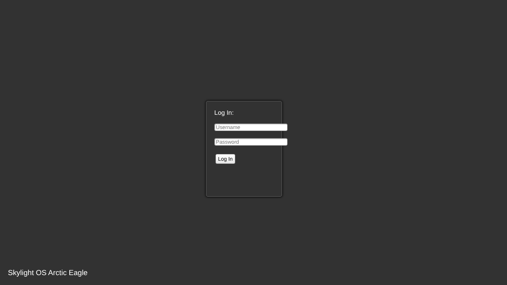
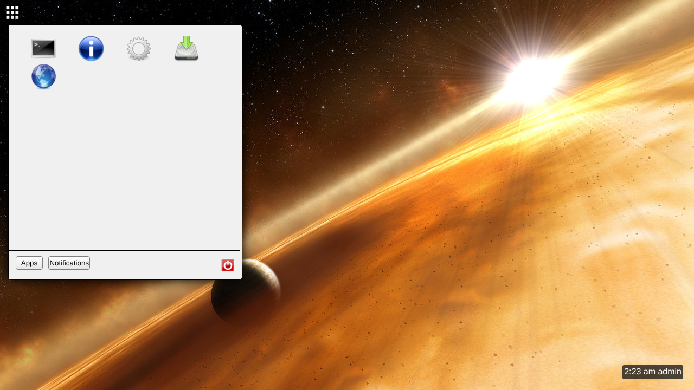

# Desktop

Everything here is part of the desktop page, [`index.html`](../siteroot/index.html).

## Login screen

Type a username and password and click **Log In** (pressing Enter doesn't submit). The desktop appears if the server accepts them. See [Users and Login](Users-and-Login.md) for what happens behind the scenes.

## The desktop

| Part | Where | What it does |
| --- | --- | --- |
| Background | whole screen | The image set for this user. Change it in the Settings app. |
| Home button | top left (grid icon) | Opens and closes the home menu. |
| Taskbar | along the top, next to the home button | One icon per open window. Click to hide or show the window; right-click for a menu. See [window](window.md). |
| Clock | bottom right | The time in 12-hour format followed by the username, updated twice a second. |
| Desktop shortcuts | top left of the desktop | Added with [App.addShortcut](App.addShortcut.md); double-click to open. |
| Toasts | top right | Pop-up [notifications](notification.md). |

## Home menu

The home menu has two tabs, chosen with the buttons at the bottom:

* **Apps** shows an icon for every app listed in `system/apps.xml` (see [Configuration Files](Configuration-Files.md)). Hover for the name; click to open. Right-clicking shows **Remove** and **Delete App**, which aren't implemented (see [Context Menus](Context-Menus.md)).
* **Notifications** is the [Notification Tray](Notification-Tray.md).

The red power button at the bottom right logs out (see [Users and Login](Users-and-Login.md)). Clicking anywhere outside the menu closes it.

---

_New page, written from the `siteroot` code. Not on the SourceForge wiki._
