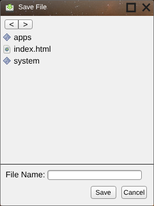

## Save File Dialog

> **This function has not yet been implemented.  Do not use it for building apps.**

The Save File Dialog is a small file browser with which users can select files from the server to save to.  It accepts one argument.  It has a counterpart in the [open file dialog](Open-File-Dialog.md).

```
var path = App.selectFileForSave();
path.then(function(file) {
    App.saveFile(file, contents);
});
```

> **In `siteroot`:** an early version of the dialog's window exists in [`system/components/save dialog/`](../siteroot/system/components/save%20dialog/), but `App.selectFileForSave` doesn't, so apps can't use it. It is listed in `system/apps.xml`, so it can be opened from the home menu as "Save File".
>
> 
>
> What works:
>
> * It is a PHP page (`index.php`) that lists the files in a folder on the server, with an icon for each file type taken from `system/images/mime/` (using `functions.php`, `mime.types` and `mime-types.xml`; see [Server Endpoints](Server-Endpoints.md#save-file-dialog-helpers)). It starts at the site root; the folder comes from the `path` query value.
> * Clicking a folder opens it (using [App.gotoLocation](App.gotoLocation.md)); the **<** and **>** buttons go back and forward.
> * Clicking a file copies its name into the **File Name** box.
>
> What doesn't:
>
> * **Save** and **Cancel** do nothing.
> * Each address adds another `path=` to the query string, so it grows as you browse.
> * The `path` value isn't checked, so the dialog will list any folder on the server the web server can read. Fix this before putting it on a public server (see [Known Issues](Known-Issues.md)).

---

_Source: [Save File Dialog](https://sourceforge.net/p/skylightos/wiki/Save%20File%20Dialog/) on the SourceForge wiki · Labels: app object, file I/O · Last modified 2014-03-11_

_Updated after reviewing the `siteroot` code._

_Updated after the `system/server` scripts were added to `siteroot`._
