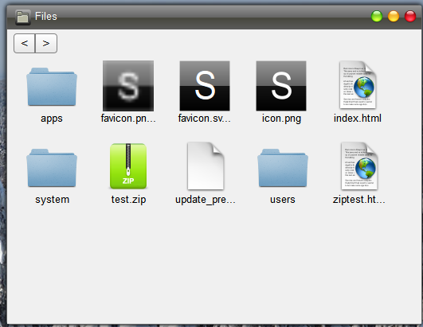
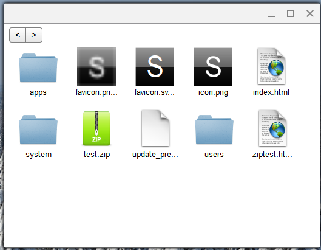

## Themes

Themes are packages that customize the look of Skylight OS.  They have root access, and can do anything they want to without requesting permission.  Therefore, only install themes that you trust implicitly.  There are some themes that come with Skylight OS by default:

default

Chrome (Chrome OS)

> **In `siteroot`:** themes don't exist. The look is fixed by [`system/css/system.css`](../siteroot/system/css/system.css) (the desktop) and [`system/css/ui.css`](../siteroot/system/css/ui.css) (controls). The only thing a user can change is the desktop background, in the Settings app (see [Built-in Apps](Built-in-Apps.md)) or with [App.setBackground](App.setBackground.md). The background is saved per user in `system/settings/<username>.xml`.

---

_Source: [Themes](https://sourceforge.net/p/skylightos/wiki/Themes/) on the SourceForge wiki · Last modified 2014-03-14_

_Updated after reviewing the `siteroot` code._
