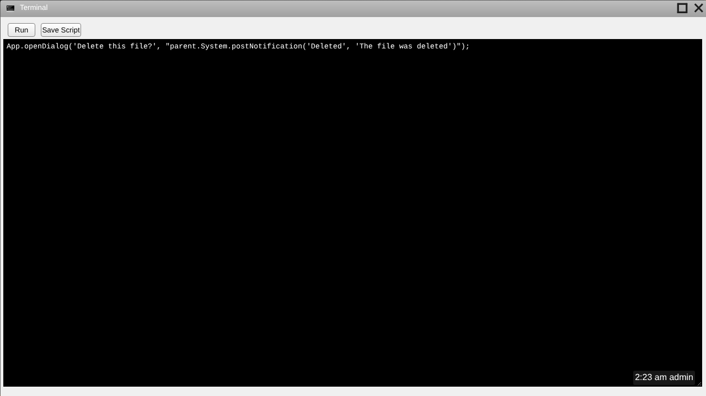

## Window

A window is the main interface an app has with the user.  The app's ui is stored in a window.  A window's attributes are stored in the app's [appData.json](appData.json.md) file.  This is a screenshot of the Terminal app:

> **In `siteroot`:** a window is a title bar plus an iframe that shows the app's page. This is the same Terminal in the Arctic Eagle code:
>
> 
>
> **Title bar.** Shows the app's small icon and title. Drag it to move the window.
>
> **Maximize button** (the square). Toggles between filling the screen and the window's normal size and position. A maximized window can't be dragged. In the code this button's CSS class is `windowActionButtonMinimize`, but it maximizes.
>
> **Close button** (the ×). Removes the window and its taskbar icon. Nothing asks the app first, so unsaved work is lost.
>
> **Taskbar icon.** Each open window adds its medium icon to the taskbar at the top of the screen. Clicking it hides the window (this is how you minimize) and clicking again shows it. Right-click it for **Close** and **Pin/Unpin**; Pin/Unpin isn't implemented and causes an error (see [Context Menus](Context-Menus.md)).
>
> Other behaviour to know:
>
> * Windows can't be resized by the user.
> * Clicking a window doesn't bring it to the front: the most recently opened window is always on top.
> * Opening an app that's already open opens a second copy.
> * Windows are opened with [App.openWindow](App.openWindow.md), from the home menu, or from a desktop shortcut, and closed with [App.closeWindow](App.closeWindow.md).
>
> 

---

_Source: [window](https://sourceforge.net/p/skylightos/wiki/window/) on the SourceForge wiki · Labels: window, UI · Last modified 2014-01-21_

_Updated after reviewing the `siteroot` code._
