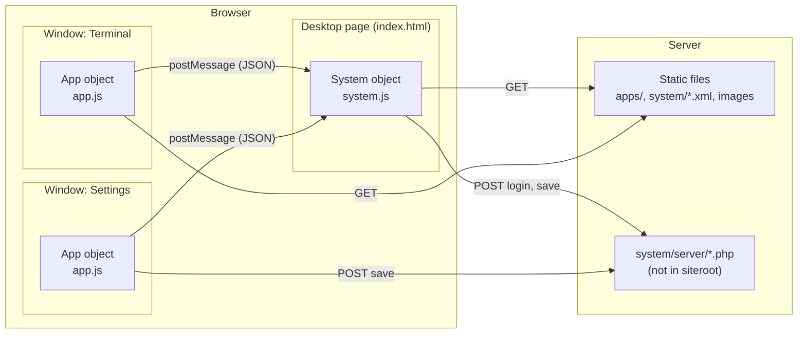
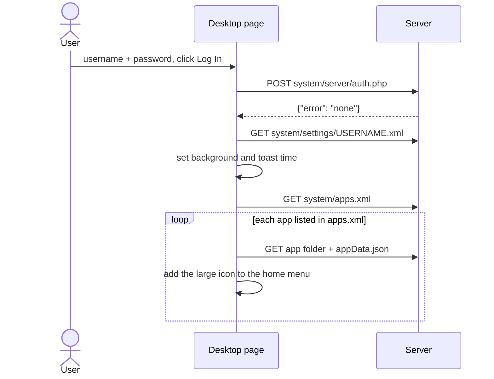
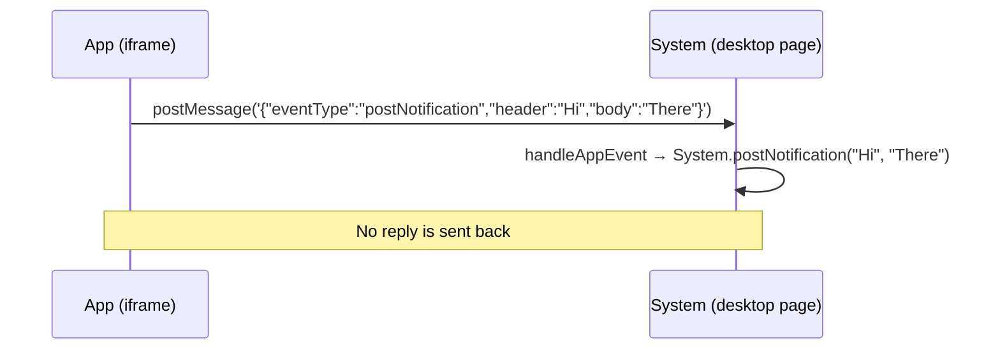

# Architecture

## Overview

Skylight OS has three layers:

1. **The desktop page**, [`index.html`](../siteroot/index.html), plus the `System` object in [`system/js/system.js`](../siteroot/system/js/system.js). It draws the login screen, desktop, windows, taskbar and menus, and owns all shared state.
2. **Apps**, each a folder of web files loaded into an `<iframe>` inside a window. Apps load [`system/js/app.js`](../siteroot/system/js/app.js), which gives them the `App` object.
3. **The server**: a web server that publishes the files, plus PHP scripts in `system/server/` for logging in and saving. The scripts aren't included in `siteroot`.



There is no framework, build step or module system: every file is loaded as is.

## Starting up



The username is stored in `System.username` and in the browser's `localStorage` (`Skylight.user`). There is no server session or token in the browser code; see [Security](security.md).

## Opening a window

`System.openWindow(path)` (also reached through `App.openWindow`, the home menu and desktop shortcuts):

1. Downloads `path + "appData.json"`, the [app manifest](app-manifest.md).
2. Creates an **AppID** with `Math.random()`. It identifies this window: it becomes the window element's `id`, part of the taskbar icon's id, and is passed to the app.
3. Builds a window element: a 30px title bar (small icon, title, maximize and close buttons) and an iframe.
4. Loads the app in the iframe at `path?app-id=<AppID>&username=<user>&undefined`. (The trailing `undefined` is a bug; see [Known issues](known-issues.md).) This query string is how an app learns its AppID and the user, so apps must keep it when they change page.
5. Sizes the window from the manifest, centers it if `position` is `"centered"` (otherwise places it at 100px, 100px), and adds the medium icon to the taskbar.

`path` is a folder relative to the site root and must end in `/`.

## How apps talk to the desktop

An app's code runs inside its own iframe. To affect the desktop, the `App` object sends a JSON string to the desktop page with `parent.postMessage(json, '*')`. The desktop's `System.handleAppEvent` parses it and calls the matching `System` function.



| `eventType` | Fields | Effect |
| --- | --- | --- |
| `openWindow` | `path` | Opens a window |
| `closeWindow` | `title` (holds an AppID) | Closes a window |
| `openDialog` | `message`, `onOK` | Opens the Dialog window |
| `postNotification` | `header`, `body`, `action` | Adds a notification |
| `setBackground` | `path` | Changes the desktop background |
| `addShortcut` | `path` | Adds a desktop shortcut |

Consequences of this design:

* **One way only.** Messages get no reply, so these `App` functions return nothing.
* **Data only.** Values pass through JSON, so functions are dropped. Where a callback is needed (the Dialog's OK button), it is passed as a string of code.
* **No sender check.** The desktop accepts these messages from any window, including web pages shown inside an app. See [Security](security.md).

Other `App` functions (reading and saving files, XML, query string helpers, navigation) run entirely inside the app and don't involve the desktop.

Apps are served from the same site as the desktop, so the browser also lets them reach the desktop directly through `parent`. The message API is the intended interface; direct access is not isolated or controlled.

## System windows

Some parts of the desktop are themselves apps opened with `openWindow`:

* **Dialog** (`system/components/dialog/`) shows a message with OK and Cancel. The desktop passes the message and the OK script through `localStorage` (`Skylight.dialog.message` and `Skylight.dialog.onOK`), and the dialog runs the script with `eval` in its own window.
* **Save File** (`system/components/save dialog/`) is an unfinished PHP file browser.

## Directory layout

```
siteroot/
├── index.html                    the desktop page
├── apps/
│   ├── default/                  built-in apps: terminal/, settings/, web browser/
│   └── panels/hello world/       sample for the unfinished panels feature
└── system/
    ├── apps.xml                  apps in the home menu
    ├── LoggedInUsers.xml         users currently logged in
    ├── settings/                 users.xml and <username>.xml per user
    ├── components/
    │   ├── dialog/               the Dialog window
    │   ├── save dialog/          the Save File window (PHP)
    │   ├── context menus/        right-click menu definitions (XML)
    │   └── login/login.wcf       unused prototype
    ├── css/                      system.css (desktop), ui.css (controls)
    ├── js/                       system.js, app.js, two unused search scripts
    ├── images/                   backgrounds, window buttons, file-type icons
    └── server/                   PHP scripts: NOT INCLUDED
```
