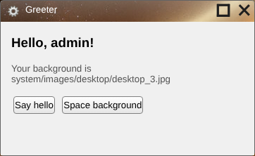

# Building your first app

This tutorial builds **Greeter**, a small app that greets the user, reads their settings, sends a notification and asks a question with a dialog. It takes about ten minutes and uses only a text editor. Every file below was tested in `siteroot`.



You'll need Skylight OS running; see [Getting started](getting-started.md).

## 1. Create the folder

An app is a folder of web files. Create it **three levels below the site root**, next to the built-in apps:

```
siteroot/apps/default/greeter/
├── appData.json
├── index.html
├── css/custom.css
├── js/greeter.js
└── icons/icon@16.png, icon@32.png, icon@48.png, icon@64.png
```

The depth matters: `App.saveFile` reaches the server by going up exactly three folders, and the paths in `index.html` below assume it too.

For the icons, copy the four PNGs from `apps/default/settings/icons/` for now. They are 16, 32, 48 and 64 pixels square.

## 2. Describe the window

`appData.json` is the [app manifest](app-manifest.md). It sets the window's title, size and icons:

```json
{
	"title": "Greeter",
	"position": "centered",
	"width": "360",
	"height": "220",
	"icons": {
		"small": "apps/default/greeter/icons/icon@16.png",
		"medium": "apps/default/greeter/icons/icon@32.png",
		"large": "apps/default/greeter/icons/icon@48.png",
		"Xlarge": "apps/default/greeter/icons/icon@64.png"
	}
}
```

Icon paths are relative to the **site root**, not to your app, because the desktop page loads them.

## 3. Write the page

`index.html` loads the shared styles (`ui.css`), the [App API](app-api.md) (`app.js`), and your own files:

```html
<!DOCTYPE html>
<html>
<head>
	<meta charset="utf-8"/>
	<link href="../../../system/css/ui.css" rel="stylesheet"/>
	<link href="css/custom.css" rel="stylesheet"/>
	<script src="../../../system/js/app.js"></script>
</head>
<body>
	<h3 id="greeting"></h3>
	<p id="background"></p>
	<button id="hello">Say hello</button>
	<button id="space">Space background</button>

	<script src="js/greeter.js"></script>
</body>
</html>
```

`css/custom.css`:

```css
body {
	margin: 15px;
}

#background {
	color: #555;
	font-size: 10pt;
}
```

## 4. Add the code

`js/greeter.js`:

```javascript
var user = App.getUsername();

// 1. Use the query string the desktop gave us.
document.getElementById('greeting').textContent = 'Hello, ' + user + '!';

// 2. Read this user's settings file. Paths for openFile are relative to this page.
var settings = App.parseXml(App.openFile('../../../system/settings/' + user + '.xml'));
var background = settings.getElementsByTagName('background')[0].getAttribute('src');
document.getElementById('background').textContent = 'Your background is ' + background;

// 3. Send a notification.
document.getElementById('hello').onclick = function () {
	App.postNotification('Greeter', 'Hello from ' + user);
};

// 4. Ask first, then act. The OK code is a string and runs inside the Dialog window.
document.getElementById('space').onclick = function () {
	App.openDialog('Switch to the space background?',
		"App.setBackground('system/images/desktop/desktop_3.jpg');");
};
```

What each part shows:

1. **The query string.** The desktop opens your page with `?app-id=...&username=...`. [`App.getUsername()`](app-api.md#appgetusername) reads it.
2. **Reading files.** [`App.openFile`](app-api.md#appopenfile) fetches a file and returns its text; paths are relative to your page, hence `../../../`. [`App.parseXml`](app-api.md#appparsexml) turns XML text into a document you can query.
3. **Notifications.** [`App.postNotification`](app-api.md#apppostnotification) adds an entry to the Notifications tab and shows a toast.
4. **Dialogs.** [`App.openDialog`](app-api.md#appopendialog) shows OK and Cancel. The second argument is **code in a string**, run in the Dialog's window when OK is clicked; it can use the `App` object there, but not your variables.

## 5. Run it

Log in, open the **Terminal** from the home menu, type this and click **Run**:

```
App.openWindow('apps/default/greeter/');
```

The path is relative to the site root and ends with `/`. The Greeter window opens; try both buttons.

## 6. Add it to the home menu

Add a line to [`system/apps.xml`](configuration.md#appsxml):

```xml
<apps>
	<app path="apps/default/terminal/"/>
	...
	<app path="apps/default/greeter/"/>
</apps>
```

Reload the page and log in again. Greeter's large icon now appears in the home menu.

## Going further

* **Saving data.** [`App.saveFile`](app-api.md#appsavefile) sends a file to the server's `saveFile.php` (see [Server API](server-api.md)). Encode the contents with `encodeURIComponent` first, and check the JSON reply.
* **More than one page.** Move between pages with [`App.gotoLocation`](app-api.md#appgotolocation), never with plain links or `location.assign`, or the new page loses its AppID and username.
* **Filling the window.** Windows have a fixed size and a 30px title bar. To fit your layout to the window, size it from `window.innerWidth` and `window.innerHeight`.
* **Looks.** See [UI components](ui-components.md) for the styles `ui.css` provides.
* **Examples.** The built-in apps in `apps/default/` are short and readable; the Settings app reads and saves XML.

## Troubleshooting

| Symptom | Likely cause |
| --- | --- |
| Nothing happens when the window should open | `appData.json` isn't valid JSON, or the path doesn't end in `/`. Check the browser's developer console. |
| Window opens but icons are missing | Icon paths in `appData.json` aren't relative to the site root. |
| `App is not defined` | The `app.js` path in `index.html` is wrong; the app may not be three levels deep. |
| `App.getUsername()` returns `undefined` | The page was reached without the desktop's query string (opened directly, or via a link). |
