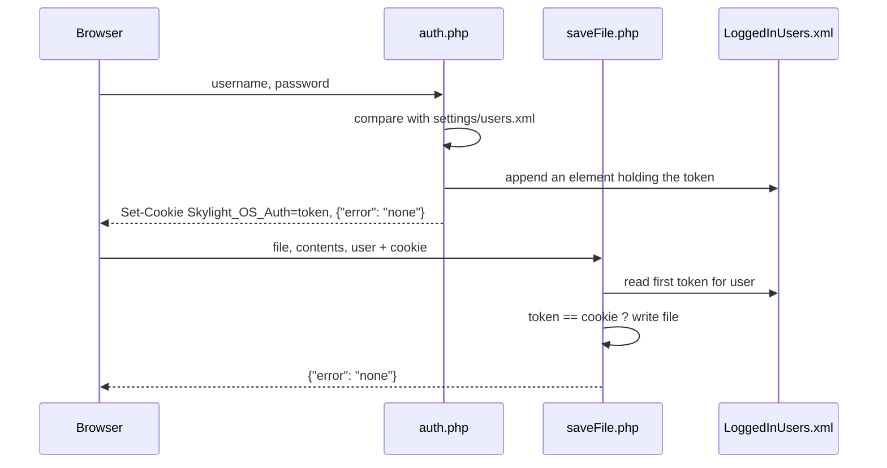

# Server API

The server side is four small PHP scripts in [`system/server/`](../siteroot/system/server/), written in PHP 5-style procedural code with no framework. They read and write XML files with PHP's `DOMDocument`.

| Script | Called by | Purpose |
| --- | --- | --- |
| [`auth.php`](#authphp) | Login screen | Check a password and start a login |
| [`saveFile.php`](#savefilephp) | `App.saveFile`, Settings, logout | Write a file for a logged-in user |
| [`shortcuts.php`](#shortcutsphp) | `App.addShortcut`, shortcut clicks | Record desktop shortcuts |
| [`functions.php`](#save-file-dialog-helpers) | Save File dialog | Look up a file's MIME type |

Every request is a synchronous `POST` with `Content-Type: application/x-www-form-urlencoded`. The scripts open their data files with relative paths (`../settings/users.xml`), so PHP must run with the script's folder as its working directory, which is the default for Apache's PHP module and PHP's built-in server.

> **The scripts are not safe on a shared network.** Anyone can write any file, including PHP code, without logging in. See [Security](security.md).

## Login flow



## auth.php

**Request:** `username`, `password`

**Response:** `{"error": "none"}` on success; `{"error": "true"}` for an unknown user or wrong password.

On success the script:

1. creates a token, `sha1(time())`;
2. sets the cookie `Skylight_OS_Auth` to the token (path `/`, domain = the request's `Host` header, expires when the browser closes, not `HttpOnly`);
3. appends `<username>token</username>` to `system/LoggedInUsers.xml`.

Things to know:

* Passwords in `system/settings/users.xml` are plain text and compared with `==`.
* **On an address with a port number the cookie is rejected.** The domain includes the port (`localhost:8000`), which browsers don't accept. Login still succeeds, but saving won't. Use port 80/443, or pass `''` as the domain to `setcookie`.
* Every login appends a new token; nothing removes old ones except logout. `saveFile.php` checks only the first, so only a user's oldest session can save.
* Usernames become XML element names in `LoggedInUsers.xml`, so they must be valid ones.
* With `display_errors` on, PHP warnings are printed before the JSON and the login screen hangs.

## saveFile.php

**Request:** `file` (path relative to the site root), `contents`, `user`, and the `Skylight_OS_Auth` cookie.

**Response:** `{"error": "none"}`, or `{"error": "Operation not performed by a logged in user"}` when the cookie doesn't match.

The script reads the first element named `user` in `LoggedInUsers.xml`; if its token `==` the cookie, it writes `contents` to `../../` + `file`.

Things to know:

* If `user` isn't logged in **and** no cookie is sent, both values are `null` and compare as equal, so the write goes ahead.
* `file` isn't checked: `../` and `.php` are allowed.
* Success is reported even if the write fails, for example because the folder doesn't exist.
* `contents` is stored exactly as PHP decoded it; apps should send it through `encodeURIComponent`.

## shortcuts.php

**Request:** `contents`, URL-encoded JSON:

```json
{"action": "add", "path": "apps/default/web browser/", "top": "30px", "left": "0px"}
```

**Response:** `NO ERROR` on success; nothing on failure.

* `add` appends `<shortcut top="30px" left="0px">apps/default/web browser/</shortcut>` to `system/server/shortcuts.xml`.
* `edit` (same fields) updates the position of every shortcut with that path, printing `NO ERROR` once per match.

No login is required and all users share one list. The desktop never reads the list back, and its drag code sends `[object Object]` instead of an `edit` request, so clicking a shortcut always ends in an error dialog. `shortcuts.json` next to it is unused test data.

## Save File dialog helpers

`system/components/save dialog/index.php` uses:

| File | Role |
| --- | --- |
| `functions.php` | `get_mime_type($filename, $mimePath = 'mime.types')`: finds the extension's MIME type in `mime.types`, or `false`. Rereads the file on every call. |
| `mime.types` | Apache's MIME table (~1,000 types) plus a custom `application/php php` line. |
| `mime-types.xml` | `<mime value="application/pdf" icon="pdf.png"/>`: 46 MIME types mapped to 14 icons in `system/images/mime/`. |

Folders get `folder.png`, executables `executable.png`, everything else without a match `file.png`.

## Data the scripts keep

| File | Contents | Publicly readable? |
| --- | --- | --- |
| `system/settings/users.xml` | Accounts and plain-text passwords | yes |
| `system/LoggedInUsers.xml` | Every active login token | yes |
| `system/server/shortcuts.xml` | Shortcuts | yes |
| `system/settings/<user>.xml` | User settings | yes |

All of them sit inside the website, so the web server serves them to anyone. The web server user needs write access to the first three and to any file users should be able to save.
