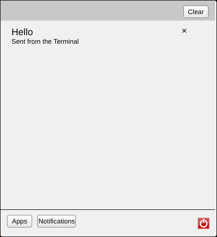
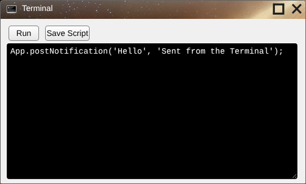
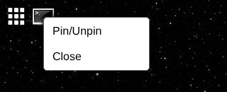
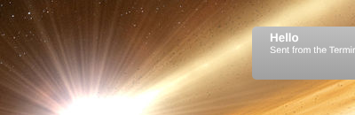
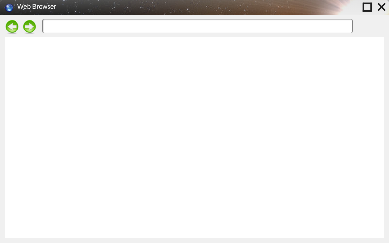

# User guide

## The desktop


| | |
| --- | --- |
| **Home button** (grid, top left) | Opens the home menu. Click it again, or anywhere else, to close it. |
| **Taskbar** (top, next to the home button) | An icon for each open window. |
| **Clock** (bottom right) | The time and the logged-in user. |
| **Shortcuts** (top left of the desktop) | App icons placed on the desktop by apps. Double-click to open. They aren't kept after a reload. |
| **Toasts** (top right) | Notifications pop up here for a few seconds. |

### Home menu

* **Apps** (the default tab): click an icon to open the app. Hover to see its name.
* **Notifications**: every notification received since you logged in. Click **×** to remove one or **Clear** to remove all.
* **Power button** (red, bottom right): logs you out. The desktop stays visible afterwards; reload the page to get back to the login screen.



## Windows



* **Move** a window by dragging its title bar.
* **Maximize** with the square button; click it again to restore. A maximized window can't be moved.
* **Close** with the × button. The app isn't asked first, so unsaved work is lost.
* **Minimize** by clicking the window's taskbar icon; click again to bring it back.
* **Right-click** a taskbar icon for a menu. Only **Close** works; **Pin/Unpin** isn't finished.



Windows can't be resized, and clicking a window doesn't bring it in front of the others. Opening an app that is already open opens a second copy.

## Notifications

Apps send notifications to tell you something happened. Each one appears briefly as a toast at the top right and stays in the home menu's Notifications tab until you remove it or reload the page. Toasts show a shortened version of the text. Because of a layout bug, most of the toast is off the edge of the screen, so read the full text in the Notifications tab.



## Built-in apps

### Terminal

Runs JavaScript. Type code and click **Run**. Every [App function](app-api.md) is available, which makes it the quickest way to try them out:

```
App.openWindow('apps/default/web browser/');
App.openDialog('Are you sure?');
App.addShortcut('apps/default/settings/');
```

If the code fails, the error is added to the end of the text as a comment. **Save Script** isn't finished.

### Settings


Click a picture to make it your desktop background. The change is immediate and is saved for next time (if the server supports saving). The notification time box and the **Add User** page aren't finished.

### Web Browser



Type an address, including `https://`, and press Enter. Many websites refuse to load inside another page and show up blank. The back and forward arrows only work for pages on the same site as Skylight OS.

### Dialog and Save File

These are parts of the system that appear in the home menu by mistake. **Dialog** is the window apps use to ask questions; opened on its own it is empty. **Save File** is an unfinished file browser. Neither is useful when opened from the menu.
