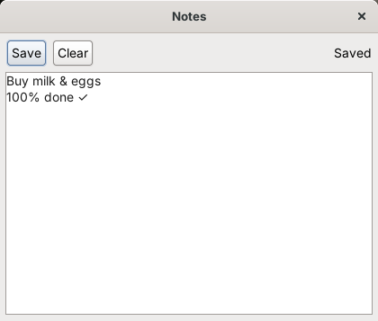

# Building your first app

This tutorial builds **Notes**, a small app that keeps one note per user. It shows the parts of the [App API](app-api.md) most apps need: building a window with widgets, reading and saving the user's files, notifications, a confirmation dialog, and stopping the window closing while there are unsaved changes. The files below were tested with PHP-GTK2.



You need Skylight OS running; see [Getting started](getting-started.md). If you're used to the browser version, the [PHP-GTK2 primer](gtk-primer.md) explains how GTK replaces HTML.

## 1. Create the folder

```
site4phpgtk/apps/notes/
├── app.json
├── app.php
└── icons/16.png, 32.png, 48.png, 64.png
```

For the icons, copy the four PNGs from `apps/settings/icons/` for now.

## 2. Describe the window

`app.json` gives the title, the class that implements the app, the starting size and the icons (see [App manifest](app-manifest.md)):

```json
{
	"title": "Notes",
	"class": "NotesApp",
	"position": "centered",
	"width": 420,
	"height": 320,
	"icons": { "16": "icons/16.png", "32": "icons/32.png", "48": "icons/48.png", "64": "icons/64.png" }
}
```

## 3. Write the class

`app.php`:

```php
<?php
/*
 * Notes: one note per user, saved in their private files.
 */
class NotesApp extends App
{
	private $buffer;    // the note's GtkTextBuffer
	private $status;    // GtkLabel
	private $changed = false;

	function build()
	{
		// 1. A toolbar and a text area.
		$save = new GtkButton('Save');
		$save->connect_simple('clicked', array($this, 'save'));
		$clear = new GtkButton('Clear');
		$clear->connect_simple('clicked', array($this, 'askToClear'));
		$this->status = new GtkLabel('Hello, ' . $this->getUsername());

		$toolbar = new GtkHBox(false, 4);
		$toolbar->pack_start($save, false, false);
		$toolbar->pack_start($clear, false, false);
		$toolbar->pack_end($this->status, false, false);

		$view = new GtkTextView();
		$view->set_wrap_mode(Gtk::WRAP_WORD);
		$scroller = new GtkScrolledWindow();
		$scroller->set_policy(Gtk::POLICY_AUTOMATIC, Gtk::POLICY_AUTOMATIC);
		$scroller->set_shadow_type(Gtk::SHADOW_IN);
		$scroller->add($view);

		$box = new GtkVBox(false, 4);
		$box->set_border_width(6);
		$box->pack_start($toolbar, false, false);
		$box->pack_start($scroller);
		$this->window->add($box);

		// 2. Load the saved note. readFile() returns null if there isn't one yet.
		$this->buffer = $view->get_buffer();
		$text = $this->readFile('notes.txt');
		if ($text !== null) {
			$this->buffer->set_text($text);
		}
		$this->buffer->connect_simple('changed', array($this, 'markChanged'));
	}

	function markChanged()
	{
		$this->changed = true;
	}

	// 3. Save. writeFile() returns array('ok' => true) or an error message.
	function save()
	{
		$text = $this->buffer->get_text($this->buffer->get_start_iter(), $this->buffer->get_end_iter());
		$result = $this->writeFile('notes.txt', $text);
		if ($result['ok']) {
			$this->changed = false;
			$this->status->set_text('Saved');
			$this->postNotification('Notes', 'Your note was saved.');
		} else {
			$this->openDialog('Could not save: ' . $result['error']);
		}
	}

	// 4. Ask before throwing work away. clear() runs only if the user clicks OK.
	function askToClear()
	{
		$this->openDialog('Clear the note? This can\'t be undone.', array($this, 'clear'));
	}

	function clear()
	{
		$this->buffer->set_text('');
		$this->status->set_text('Cleared (not saved yet)');
	}

	// 5. Don't lose unsaved work when the window is closed.
	function canClose()
	{
		if (!$this->changed) {
			return true;
		}
		$this->openDialog('Close without saving your changes?', array($this, 'closeAnyway'));
		return false;
	}

	function closeAnyway()
	{
		$this->changed = false;
		$this->closeWindow();
	}
}
```

How it works:

1. **`build()`** creates the widgets and puts them in `$this->window`. Boxes (`GtkVBox`, `GtkHBox`) stack widgets; `pack_start($widget, false, false)` gives a widget only the space it needs, and plain `pack_start($widget)` lets it fill the rest.
2. **Signals:** `connect_simple('clicked', array($this, 'save'))` calls `$this->save()` when the button is clicked. PHP 5.2 has no anonymous functions, so every callback is a named method.
3. **Files:** `readFile` and `writeFile` use the user's private storage, so each user has their own `notes.txt`.
4. **Dialogs:** the method named in `openDialog` runs only if the user clicks OK.
5. **`canClose()`** is called when the user closes the window. Returning `false` keeps it open; here it asks first and closes with `closeWindow()` if the user agrees.

## 4. Run it

Open the **Terminal** from the home menu and run:

```php
$app->openWindow('apps/notes/');
```

Type something, click **Save**, close the window and open it again: the note is still there. Change it and try to close the window without saving: you'll be asked first.

If something is wrong in `app.php`, PHP stops with an error. Run Skylight with `php skylight.php` (not `php-win`) while developing, so you can see the message.

## 5. Add it to the home menu

Add the folder to `apps/apps.json`:

```json
[
	"apps/terminal/",
	"apps/settings/",
	"apps/web-browser/",
	"apps/notes/"
]
```

Log out and in again: Notes now has an icon in the home menu. You can also put it on the desktop with `$app->addShortcut('apps/notes/')` in the Terminal.

## Troubleshooting

| Symptom | Likely cause |
| --- | --- |
| "Cannot open app" notification | `app.json` is missing, isn't valid JSON, or lacks `title`, `class` or `icons` |
| Skylight closes when the app opens | A PHP error in `app.php`, or `class` in `app.json` doesn't match the class name. Run `php skylight.php` to see the message. |
| `Cannot redeclare class` | Two apps use the same class name |
| Empty window | `build()` didn't call `$this->window->add(...)` |
| Accented letters look wrong | Text must be UTF-8; save `app.php` as UTF-8 |
