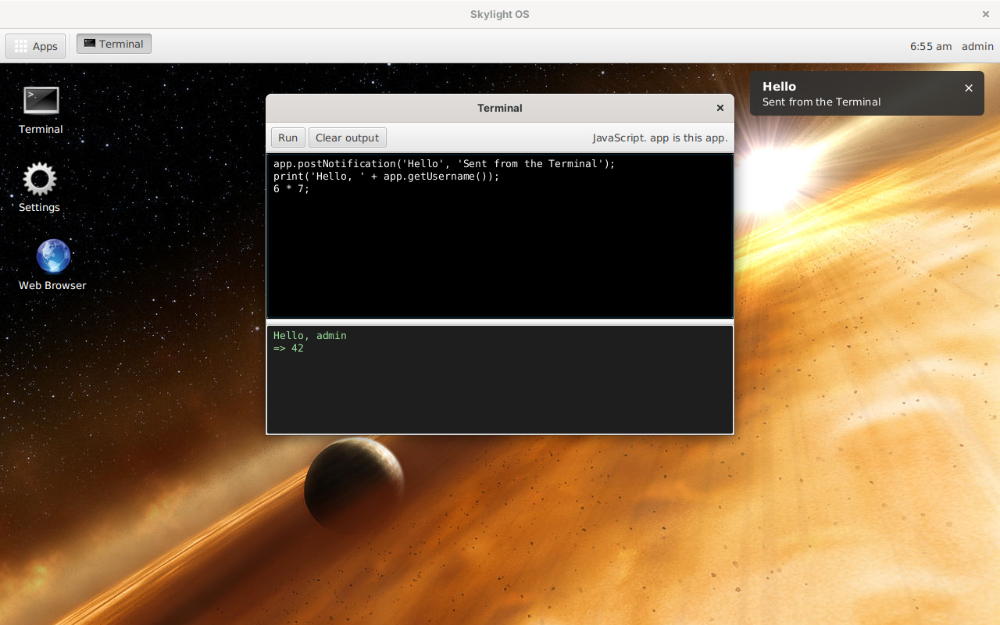

# Skylight OS for Java 8 and JavaFX 8

This is Skylight OS rebuilt as a Java desktop program using **JavaFX 8** and its default **Modena** look. The code is in [`../site5jfx`](../site5jfx).

One Java process draws the desktop, and every app is a Java class with its own real window. It keeps the design shared by the other versions: login, a desktop with a background and shortcuts, a home menu, notifications, and the same App API names. Two things the browser-free PHP-GTK2 version ([`../wiki4phpgtk`](../wiki4phpgtk/README.md)) couldn't do come back:

* **The Web Browser shows real web pages**, using JavaFX's built-in WebKit engine.
* **The Terminal runs JavaScript** again, using Java 8's built-in Nashorn engine (ES5.1).

## Contents

**Using Skylight OS**

* [Getting started](getting-started.md): build, add a user, run
* [User guide](user-guide.md): the desktop, windows, notifications and the built-in apps

**Building apps**

* [Building your first app](building-apps.md): a step-by-step tutorial
* [App manifest](app-manifest.md): the `app.properties` file
* [App API](app-api.md): the `App` base class
* [JavaFX primer](javafx-primer.md): JavaFX ideas Skylight uses

**How it works**

* [Architecture](architecture.md)
* [Desktop internals](desktop-internals.md)
* [Data and configuration](data-and-configuration.md)

**Background**

* [Compared with the other versions](comparison.md)
* [Security](security.md)
* [Limitations](limitations.md)

## At a glance

| | |
| --- | --- |
| Language | Java 8 (lambdas, no later features) |
| UI | JavaFX 8, default Modena look, plus a small stylesheet |
| Runs on | Windows, Linux or macOS with a Java 8 JDK that includes JavaFX |
| Libraries | None beyond Java 8 and JavaFX 8 |
| Data | `.properties` files in `data/` |
| Size | About 1,070 non-blank lines of Java in 9 files, plus 80 lines of CSS |
| Tested | On Linux with OpenJDK 1.8.0_504 and OpenJFX 8u161 (see [Limitations](limitations.md#how-it-was-tested)) |
