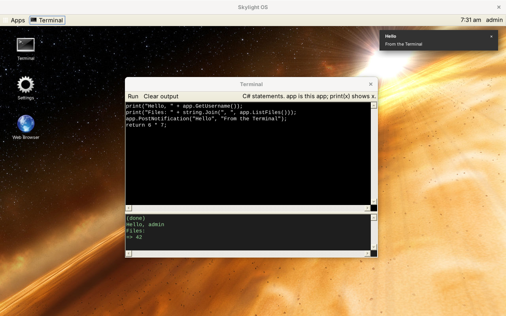

# Skylight OS for C# 5 and Windows Forms

This is Skylight OS rebuilt as a Windows desktop program in **C# 5**, using **Windows Forms** and nothing else. It is compiled by the `csc.exe` that is already part of Windows 11 (in the .NET Framework 4.8 folder), so there's nothing to install: no Visual Studio, no .NET SDK, no NuGet packages. The code is in [`../site6cs`](../site6cs).

One program, `Skylight.exe`, draws the desktop, and every app is a C# class with its own real window. It keeps the design shared by the other versions: login, a desktop with a background and shortcuts, a home menu, notifications, and the same App API names (in C#'s PascalCase). In this version:

* **The Terminal runs C#.** Each run is compiled on the spot by the same C# compiler that built Skylight, and `app` is the Terminal itself.
* **The Web Browser** uses the WinForms `WebBrowser` control, which on Windows is the Internet Explorer 11 engine.
* **Apps can ship as a DLL.** An app that isn't built in brings its own `app.dll`, compiled against `Skylight.exe`.

The screenshots were taken on Linux with **Mono**, which runs the same `Skylight.exe` but draws Windows Forms in its own classic style. On Windows 11 the same windows use the native Windows 11 controls and title bars. See [Limitations](limitations.md#how-it-was-tested).

## Contents

**Using Skylight OS**

* [Getting started](getting-started.md): build, add a user, run
* [User guide](user-guide.md): the desktop, windows, notifications and the built-in apps

**Building apps**

* [Building your first app](building-apps.md): a step-by-step tutorial
* [App manifest](app-manifest.md): the `app.json` file
* [App API](app-api.md): the `App` base class
* [Windows Forms primer](winforms-primer.md): the C# 5 and WinForms ideas Skylight uses

**How it works**

* [Architecture](architecture.md)
* [Desktop internals](desktop-internals.md)
* [Data and configuration](data-and-configuration.md)

**Background**

* [Compared with the other versions](comparison.md)
* [Security](security.md)
* [Limitations](limitations.md)

## At a glance

| | |
| --- | --- |
| Language | C# 5 (lambdas, LINQ; none of C# 6's `?.`, `$"..."` or `nameof`) |
| UI | Windows Forms, with the system's own look |
| Runs on | Windows 11 (or Windows 7 and later with .NET Framework 4.5+); also Linux and macOS with Mono |
| Compiler | `csc.exe` from `%WINDIR%\Microsoft.NET\Framework64\v4.0.30319\` |
| Libraries | None beyond the .NET Framework |
| Data | JSON files in `data\`, read and written with `JavaScriptSerializer` |
| Size | About 1,400 non-blank lines of C# in 12 files |
| Tested | On Linux with Mono 6.8, compiled as C# 5 (see [Limitations](limitations.md#how-it-was-tested)) |
