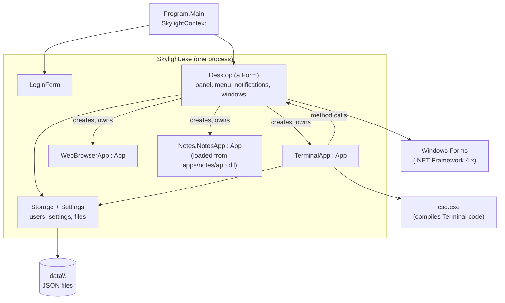

# Architecture

## One Windows program

| Class | File | Job |
| --- | --- | --- |
| `Program`, `SkylightContext` | [`Program.cs`](../site6cs/src/Skylight/Program.cs) | Starts Windows Forms and switches between the login window and the desktop |
| `LoginForm` | [`LoginForm.cs`](../site6cs/src/Skylight/LoginForm.cs) | The login window |
| `Desktop` | [`Desktop.cs`](../site6cs/src/Skylight/Desktop.cs) | Panel, background, shortcuts, home menu, notifications, dialogs, app windows. See [Desktop internals](desktop-internals.md). |
| `DesktopArea`, `ShortcutIcon`, `Toast` | [`DesktopArea.cs`](../site6cs/src/Skylight/DesktopArea.cs) | The custom-drawn desktop surface, shortcuts and toasts |
| `App`, `Result` | [`App.cs`](../site6cs/src/Skylight/App.cs) | Base class for apps; the [App API](app-api.md) |
| `Settings`, `Shortcut` | [`Settings.cs`](../site6cs/src/Skylight/Settings.cs) | A user's background, notification time and shortcuts |
| `Storage` | [`Storage.cs`](../site6cs/src/Skylight/Storage.cs) | Users and passwords, settings, app list, user files under `data\` |
| `AddUser` | [`AddUser.cs`](../site6cs/src/AddUser/AddUser.cs) | Console tool to add users (built into `AddUser.exe` with `Storage.cs`) |
| Built-in apps | [`Apps\`](../site6cs/src/Skylight/Apps/) | `TerminalApp`, `SettingsApp`, `WebBrowserApp` |

Everything except `AddUser` is compiled into `Skylight.exe`. The `apps\`, `images\` and `data\` folders sit beside it.

## How it runs

1. `Program.Main` runs a `SkylightContext`, an `ApplicationContext` that keeps Windows Forms running while windows come and go.
2. The context shows a `LoginForm`. When it closes with a username, the context creates a `Desktop` for that user; when it closes without one (**Quit**), the context ends the program.
3. The `Desktop` is a maximized `Form` with the panel (a `ToolStrip`) at the top and a `DesktopArea` filling the rest. It builds the home menu and starts a one-second clock `Timer`.
4. From here, Windows Forms calls Skylight's code on its UI thread when something happens: a click, a timer, a window being closed.
5. Logging out closes the desktop; its `FormClosed` event makes the context show a new login window.

## Apps are classes

`Desktop.OpenWindow("apps/terminal/", args)`:

1. reads `apps/terminal/app.json` (see [App manifest](app-manifest.md));
2. finds the class it names: in `Skylight.exe` for built-in apps, or in the DLL named by `assembly` (with `Assembly.LoadFrom`), and checks that it extends `App`;
3. creates it with `Activator.CreateInstance`, and creates a `Form` for it;
4. gives the app its context (`App.Init`) and calls `Build()`, which returns the window's contents;
5. adds a button to the window list and shows the window, owned by the desktop.

AppIDs are numbers, as strings, counting up from 1.

Apps call the desktop through the methods they inherit from `App`. Callbacks are ordinary C# delegates (`Action`), so a lambda or anonymous method works.

## The Terminal compiles C#

The Terminal wraps the typed statements in a static method, compiles them with `CSharpCodeProvider` (which runs the framework's `csc.exe`), and calls the method with reflection, passing itself as `app`. A `#line 1` directive makes compile errors report line numbers from the user's code. Each run produces a small in-memory assembly that stays loaded until Skylight exits.

## Real windows

Each app window is a real top-level window, so Windows moves, resizes, stacks and minimizes it. The desktop only keeps the window list in step.

## Data

There's no server. `Storage` reads and writes JSON files in `data\` with the framework's `JavaScriptSerializer` (see [Data and configuration](data-and-configuration.md)).
