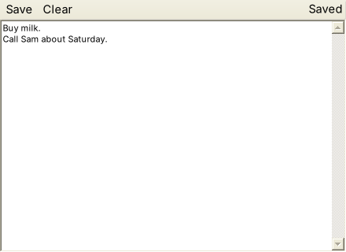

# Building your first app

This tutorial builds **Notes**, an app that keeps one note per user, as a separate app with its own `app.dll`, the way any app that isn't built into Skylight is packaged. It covers the parts of the [App API](app-api.md) most apps need: building a window, reading and saving the user's files, notifications, a confirmation dialog, and stopping the window closing while there are unsaved changes. Every step was tested (on Mono; see [Limitations](limitations.md#how-it-was-tested)).



You need Skylight OS built and running; see [Getting started](getting-started.md).

## 1. Create the folder

```
site6cs\apps\notes\
├── app.json
├── src\NotesApp.cs
└── icons\16.png, 32.png, 48.png, 64.png
```

For the icons, copy the four PNGs from `apps\settings\icons\` for now.

## 2. Describe the app

`app.json` (see [App manifest](app-manifest.md)):

```json
{
	"title": "Notes",
	"class": "Notes.NotesApp",
	"assembly": "app.dll",
	"width": 440,
	"height": 320,
	"icons": { "16": "icons/16.png", "32": "icons/32.png", "48": "icons/48.png", "64": "icons/64.png" }
}
```

`"assembly"` tells Skylight to load the class from `app.dll` in this folder.

## 3. Write the class

`src\NotesApp.cs`:

```csharp
using System.Windows.Forms;
using Skylight;

namespace Notes
{
	/// <summary>Notes: one note per user, saved in their private files.</summary>
	public class NotesApp : App
	{
		readonly TextBox note = new TextBox();
		readonly ToolStripLabel status = new ToolStripLabel();
		bool changed = false;

		// 1. Build the window: a toolbar above a text box.
		protected override Control Build()
		{
			ToolStrip toolbar = new ToolStrip { GripStyle = ToolStripGripStyle.Hidden };
			toolbar.Items.Add("Save", null, delegate { Save(); });
			toolbar.Items.Add("Clear", null, delegate { AskToClear(); });
			status.Text = "Hello, " + GetUsername();
			status.Alignment = ToolStripItemAlignment.Right;
			toolbar.Items.Add(status);

			// 2. Load the saved note. ReadFile() returns null if there isn't one yet.
			note.Multiline = true;
			note.ScrollBars = ScrollBars.Vertical;
			note.Dock = DockStyle.Fill;
			note.Text = ReadFile("notes.txt") ?? "";
			note.SelectionStart = note.Text.Length;   // cursor at the end, rather than all text selected
			note.TextChanged += delegate { changed = true; };

			Panel root = new Panel();
			root.Controls.Add(note);
			root.Controls.Add(toolbar);   // added last, so it docks first, at the top
			return root;
		}

		// 3. Save. WriteFile() reports success, or an error to show the user.
		void Save()
		{
			Result result = WriteFile("notes.txt", note.Text);
			if (result.Ok)
			{
				changed = false;
				status.Text = "Saved";
				PostNotification("Notes", "Your note was saved.");
			}
			else
			{
				OpenDialog("Could not save: " + result.Error);
			}
		}

		// 4. Ask before throwing work away. The lambda runs only if the user clicks OK.
		void AskToClear()
		{
			OpenDialog("Clear the note? This can't be undone.", () =>
			{
				note.Clear();
				status.Text = "Cleared (not saved yet)";
			});
		}

		// 5. Don't lose unsaved work when the window is closed.
		protected override bool CanClose()
		{
			if (!changed)
			{
				return true;
			}
			OpenDialog("Close without saving your changes?", () =>
			{
				changed = false;
				CloseWindow();
			});
			return false;
		}
	}
}
```

How it works:

1. **`Build()`** returns the window's contents: a `Panel` holding a `ToolStrip` docked at the top and a `TextBox` filling the rest. Controls dock in the reverse of the order they were added, which is why the toolbar is added last.
2. **Events** use anonymous methods (`delegate { Save(); }`) or lambdas. `TextChanged` notices every edit.
3. **Files:** `ReadFile` and `WriteFile` use the user's private storage, so each user has their own `notes.txt`. `??` gives `""` when there's no note yet.
4. **Dialogs:** the lambda given to `OpenDialog` runs only if the user clicks OK.
5. **`CanClose()`** keeps the window open while there are unsaved changes, and closes it with `CloseWindow()` if the user agrees.

`Build()` and `CanClose()` are declared `protected internal` in `App`. An app in its own DLL overrides them as plain **`protected override`**, because the `internal` part only applies inside `Skylight.exe`; C# reports error CS0507 if you copy `protected internal` across.

## 4. Compile it into app.dll

From `apps\notes\`, on Windows:

```
set CSC=%WINDIR%\Microsoft.NET\Framework64\v4.0.30319\csc.exe
%CSC% /nologo /target:library /out:app.dll /reference:..\..\Skylight.exe /reference:System.Windows.Forms.dll /reference:System.Drawing.dll src\NotesApp.cs
```

With Mono:

```
mcs -langversion:5 -target:library -out:app.dll -r:../../Skylight.exe -r:System.Windows.Forms.dll -r:System.Drawing.dll src/NotesApp.cs
```

`/reference:..\..\Skylight.exe` lets the compiler see `Skylight.App`; an `.exe` can be referenced just like a DLL. Skylight loads `app.dll` the first time the app opens. After changing the code, rebuild `app.dll` and restart Skylight: Windows keeps a loaded DLL locked until the program ends.

## 5. Run it

Open the **Terminal** and run:

```csharp
app.OpenWindow("apps/notes/");
```

Type something, click **Save**, close the window and open it again: the note is still there. Change it and close the window without saving: you'll be asked first.

## 6. Add it to the home menu

Add the folder to `apps\apps.json`:

```json
[
	"apps/terminal/",
	"apps/settings/",
	"apps/web-browser/",
	"apps/notes/"
]
```

Log out and in again: Notes appears in the home menu. `app.AddShortcut("apps/notes/");` in the Terminal puts it on the desktop.

## Troubleshooting

| Symptom | Likely cause |
| --- | --- |
| "Cannot open app" with `TypeLoadException` | `class` in `app.json` doesn't match the namespace and class name |
| "Cannot open app" with `FileNotFoundException` | `app.dll` is missing, or `assembly` names the wrong file |
| "Cannot open app" mentioning `app.json` | A key is missing, or the JSON has a mistake (a missing comma or quote) |
| error CS0507 when compiling | `protected internal override`: use `protected override` |
| error CS0012 about `System.Drawing` | Add `/reference:System.Drawing.dll` |
| `csc` can't find `Skylight.App` | Build Skylight first (`build.bat`), and check the `/reference` path |
| Can't rebuild `app.dll` ("being used by another process") | Close Skylight first |
