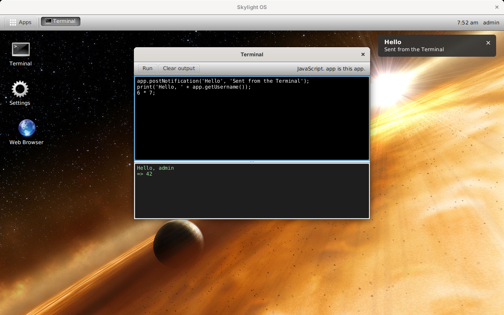

# Skylight OS for Java 7 and JavaFX 2.2

This is Skylight OS rebuilt as a Java desktop program for **Java 7** and **JavaFX 2.2**, the JavaFX that ships inside Oracle's JDK 7 (update 6 and later), with JavaFX 2.2's default **Caspian** look. The code is in [`../site7java7`](../site7java7).

It's a port of the [Java 8 and JavaFX 8 version](../wiki5jfx/README.md) to the older platform, with the same design, the same App API and the same apps. Java 7 has no lambdas, so event handlers are anonymous classes, and JavaFX 2.2 is missing a few things JavaFX 8 added, so Skylight provides its own:

* **Dialogs**: JavaFX 2.2 has no `Alert`, so `openDialog` builds a small window.
* **The notification-time setting** is a slider, since there's no `Spinner`.
* **Filling the screen**: there's no `setMaximized`, so the desktop sizes itself to the screen.
* **Screen positions**: there's no `localToScreen`, so Skylight works them out itself.

The Terminal still runs JavaScript (Java 7's built-in Rhino engine), and the Web Browser still shows real web pages (JavaFX 2.2's WebView).

## Contents

**Using Skylight OS**

* [Getting started](getting-started.md): build, add a user, run
* [User guide](user-guide.md): the desktop, windows, notifications and the built-in apps

**Building apps**

* [Building your first app](building-apps.md): a step-by-step tutorial
* [App manifest](app-manifest.md): the `app.properties` file
* [App API](app-api.md): the `App` base class
* [Java 7 and JavaFX 2.2 primer](javafx-primer.md): the ideas Skylight uses, and what's missing compared with Java 8

**How it works**

* [Architecture](architecture.md)
* [Desktop internals](desktop-internals.md)
* [Data and configuration](data-and-configuration.md)

**Background**

* [Compared with the other versions](comparison.md)
* [Security](security.md)
* [Limitations](limitations.md)

## At a glance

| | |
| --- | --- |
| Language | Java 7 (no lambdas: anonymous classes) |
| UI | JavaFX 2.2, default Caspian look, plus a small stylesheet |
| Runs on | Windows, Linux or macOS with Oracle JDK 7u6 or later; also Java 8 with JavaFX |
| Libraries | None beyond Java 7 and JavaFX 2.2 |
| Data | `.properties` files in `data/` |
| Size | About 1,340 non-blank lines of Java in 9 files, plus 80 lines of CSS |
| Tested | Compiled as Java 7 and checked against the JavaFX 2.2 API; run on Java 8 with JavaFX's Caspian look (see [Limitations](limitations.md#how-it-was-tested)) |
