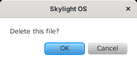

# App API

An app is a class that extends `skylight.App` ([`App.java`](../site5jfx/src/skylight/App.java)) and returns its window's contents from `build()`:

```java
package hello;

import javafx.event.ActionEvent;
import javafx.event.EventHandler;
import javafx.scene.Parent;
import javafx.scene.control.Button;
import javafx.scene.layout.StackPane;
import skylight.App;

public class HelloApp extends App {
	@Override
	protected Parent build() {
		Button button = new Button("Say hello");
		button.setOnAction(new EventHandler<ActionEvent>() {
			@Override
			public void handle(ActionEvent e) {
				postNotification("Hello", "Hello, " + getUsername());
			}
		});
		StackPane root = new StackPane();
		root.getChildren().add(button);
		return root;
	}
}
```

The method names match the other versions' App APIs (see [Compared with the other versions](comparison.md)). Apps need a public no-argument constructor (the default one is fine).

## Lifecycle

| Method | When | What to do |
| --- | --- | --- |
| `Parent build()` | Once, before the window is shown | Create your controls and return the root node |
| `boolean canClose()` | When the user closes the window | Return `true` to allow it, `false` to keep the window open (for example, to ask about unsaved work first) |

## Fields

| Field | Holds |
| --- | --- |
| `window` | Your `Stage` |
| `appID` | This window's ID |
| `path` | Your folder, e.g. `apps/notes/` |
| `manifest` | Your `app.properties` |
| `args` | The map passed to `openWindow(path, args)`, or an empty map |
| `desktop` | The `Desktop`; prefer the methods below |

## Summary

| Method | Returns |
| --- | --- |
| [`openWindow(path)`, `openWindow(path, args)`](#openwindow) | AppID, or `null` |
| [`closeWindow()`, `closeWindow(appID)`](#closewindow) | — |
| [`openDialog(message)`, `openDialog(message, onOK)`](#opendialog) | — |
| [`postNotification(header)`, `postNotification(header, body)`](#postnotification) | — |
| [`getSettings()`](#getsettings) | `Settings` (a copy) |
| [`saveSettings(settings)`](#savesettings) | `boolean` |
| [`setBackground(imagePath)`](#setbackground) | `boolean` |
| [`addShortcut(appPath)`](#addshortcut) | — |
| [`getAppID()`](#identity) | `String` |
| [`getUsername()`](#identity) | `String` |
| [`appFile(name)`](#appfile) | `Path` |
| [`listFiles()`](#listfiles-readfile-writefile) | `List<String>` |
| [`readFile(name)`](#listfiles-readfile-writefile) | `String`, or `null` |
| [`writeFile(name, contents)`](#listfiles-readfile-writefile) | `App.Result` |

## Windows

### openWindow

```java
openWindow("apps/settings/");

Map<String, String> args = new HashMap<>();   // Java 7's "diamond" works
args.put("file", "todo.txt");
openWindow("apps/notes/", args);   // NotesApp reads args.get("file")
```

Opens an app in a new window and returns its AppID. If the folder isn't a working app, the user gets a notification and `null` is returned.

### closeWindow

```java
closeWindow();         // this window
closeWindow(appID);    // another one
```

Closes without asking: `canClose()` isn't called.

## Dialogs and notifications

### openDialog

```java
openDialog("The file was saved.");                      // OK only
openDialog("Delete this note?", new Runnable() {        // OK and Cancel
	@Override
	public void run() {
		deleteNote();
	}
});
```

With `onOK`, the user sees a question with **OK** and **Cancel**, and `onOK.run()` is called only on OK. Closing the dialog with its × counts as Cancel. Variables the `Runnable` uses from the surrounding method must be `final` (Java 7 rule).

JavaFX 2.2 has no `Alert`, so the dialog is a small `Stage` that Skylight builds, owned by your window and **window-modal**: your window waits for an answer, the rest of Skylight doesn't. `openDialog` returns straight away; the answer arrives later through `onOK`.



### postNotification

```java
postNotification("Download complete", "report.pdf was saved.");
```

Shows a toast and adds the notification to the home menu. The body is optional.

## Settings and the desktop

### getSettings

```java
Settings settings = getSettings();
settings.background;         // "images/backgrounds/3.jpg"
settings.notificationTime;   // 7000 (milliseconds)
settings.shortcuts;          // List<Settings.Shortcut>: path, x, y
```

Returns a **copy**: changing it has no effect until you save it.

### saveSettings

```java
Settings settings = getSettings();
settings.notificationTime = 3000;
saveSettings(settings);
```

Checks, saves and applies the settings. Returns `false`, after telling the user why, if they were refused (see [Data and configuration](data-and-configuration.md#settings)).

### setBackground

```java
setBackground("images/backgrounds/2.jpg");
```

### addShortcut

```java
addShortcut("apps/notes/");
```

Adds a desktop shortcut (saved with the user's settings). Adding one that exists does nothing.

## Identity

`getAppID()` returns this window's ID; `getUsername()` the logged-in user.

## Files

### appFile

```java
Image logo = new Image(appFile("images/logo.png").toUri().toString());   // java.nio.file.Path, new in Java 7
```

A file in your app's own folder.

### listFiles, readFile, writeFile

```java
List<String> names = listFiles();               // the user's own files
String text = readFile("notes.txt");            // null if there's no such file
App.Result result = writeFile("notes.txt", text);
if (!result.ok) {
	openDialog("Could not save: " + result.error);
}
```

Files are stored as UTF-8 in `data/users/<name>/files/`. Names may use letters, digits, spaces, `-`, `_` and `.` (up to 100 characters, not starting with `.`), so they can't point outside the user's folder.

## Threads

JavaFX calls your code on its application thread, and all `App` methods must be called there too. If you start work on another thread, return to the JavaFX thread with `Platform.runLater(new Runnable() { ... })` before calling the App API or touching controls.
