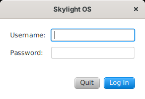

# Getting started

## Requirements

**Oracle JDK 7, update 6 or later** (the last is 7u80). From update 6, the JDK includes **JavaFX 2.2** as `jre\lib\jfxrt.jar`. Java 7 doesn't put that file on the class path by itself, so Skylight's scripts find it for you through `JAVA_HOME`:

```
set JAVA_HOME=C:\Program Files\Java\jdk1.7.0_80          (Windows)
export JAVA_HOME=/usr/lib/jvm/jdk1.7.0_80               (Linux, macOS)
```

OpenJDK 7 builds don't include JavaFX. A **Java 8 JDK with JavaFX** (Oracle JDK 8, Zulu FX, Liberica Full) also works: it builds the same Java 7 code and runs it with JavaFX 8, which is compatible.

## Build

From the `site7java7` folder:

```
build.bat          (Windows)
./build.sh         (Linux, macOS)
```

This compiles `src/` with `javac -source 7 -target 7` into `skylight.jar`. If `JAVA_HOME` isn't set, or has no `jfxrt.jar`, `build.bat` says so.

## Add a user

```
"%JAVA_HOME%\bin\java" -cp skylight.jar skylight.AddUser admin choose-a-password
```

(`"$JAVA_HOME/bin/java" -cp skylight.jar ...` on Linux and macOS.) The tool doesn't need JavaFX. Run it again to change a password. Usernames may use letters, digits, `-` and `_`.

## Run

```
run.bat            (Windows: starts with javaw, no console window)
./run.sh           (Linux, macOS)
```

Both put `skylight.jar` and `jfxrt.jar` on the class path and start `skylight.Main`. By hand:

```
"%JAVA_HOME%\bin\java" -cp "skylight.jar;%JAVA_HOME%\jre\lib\jfxrt.jar" skylight.Main
```

(use `:` instead of `;` on Linux and macOS). Skylight looks for `apps/`, `images/` and `data/` in the current folder; to start it from elsewhere, add `-Dskylight.home=C:\path\to\site7java7`.

## Log in



Enter your username and password and press Enter. **Quit** (or Escape) closes Skylight OS.

## Next steps

* Take the [user guide](user-guide.md) tour.
* Open the **Terminal** and run `app.postNotification('Hello', 'It works');`.
* [Build your first app](building-apps.md).
