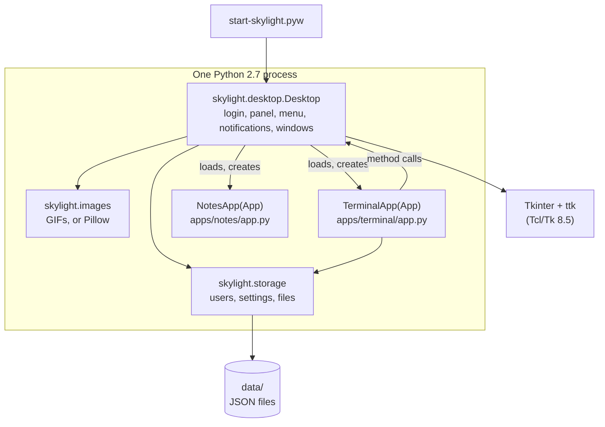

# Architecture

## One Python process

| File | Job |
| --- | --- |
| [`start-skylight.pyw`](../site8py27tk/start-skylight.pyw) | Entry point: puts the folder on `sys.path` and starts a `Desktop` |
| [`skylight/desktop.py`](../site8py27tk/skylight/desktop.py) | `Desktop`: login, panel, background, shortcuts, home menu, notifications, dialogs, app windows. See [Desktop internals](desktop-internals.md). |
| [`skylight/app.py`](../site8py27tk/skylight/app.py) | `App`, the base class for apps: the [App API](app-api.md) |
| [`skylight/storage.py`](../site8py27tk/skylight/storage.py) | Users and passwords, settings, app list, user files under `data/` |
| [`skylight/images.py`](../site8py27tk/skylight/images.py) | Loading and scaling pictures for Tk |
| [`add-user.py`](../site8py27tk/add-user.py) | Command-line tool to add users |
| `apps/<name>/app.py` | Each app's class, built-in apps included |

## How it runs

1. `start-skylight.pyw` creates a `Desktop`, which creates the hidden `Tk` root window, and calls `start()`: it shows the login window and enters Tk's event loop (`mainloop`).
2. A correct password destroys the login window and calls `showDesktop()`, which builds a maximized `Toplevel` (panel and canvas), the home menu (a hidden borderless `Toplevel`), and starts the clock with `after(1000, ...)`.
3. From here, Tk calls Skylight's code when something happens: a click, a key, a timer.
4. Logging out closes everything and shows the login window again. **Quit** destroys the root window, which ends `mainloop` and the program.

## Apps are Python files

`Desktop.openWindow('apps/terminal/', args)`:

1. reads `apps/terminal/app.json` (see [App manifest](app-manifest.md));
2. loads `apps/terminal/app.py` with `imp.load_source` (the first time only) and finds the class named by `class`, checking it extends `App`;
3. creates a `Toplevel`, transient to the desktop so it stays in front of it;
4. creates the app object with its context and calls `build()`;
5. adds a toggle button to the window list, places the window over the middle of the desktop and shows it.

AppIDs are numbers, as strings, counting up from 1. Apps call the desktop through the methods they inherit from `App`; callbacks are plain Python functions.

There's no build step: the built-in apps are loaded exactly like any other, so the Terminal, Settings and Web Browser are also examples of how to write an app.

## Pictures

Tk 8.5 reads only GIF and PPM, so icons are GIFs and each background JPEG has a GIF copy. [`images.py`](../site8py27tk/skylight/images.py) uses Pillow when it's installed (smooth scaling from the JPEG), and otherwise loads the GIF and scales it with Tk's `zoom` and `subsample`, choosing the smallest fraction that still covers the desktop.

## Data

There's no server. `storage` reads and writes JSON files in `data/` with Python's `json` module, in the same formats as the PHP-GTK2 version (see [Data and configuration](data-and-configuration.md)).
