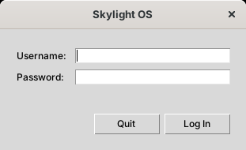

# Getting started

## Requirements

**Python 2.7.8 or later** (the last release is 2.7.18) with **Tkinter**.

* **Windows:** the python.org installer includes Tkinter (with Tcl/Tk 8.5); keep "Tcl/Tk" selected when installing. It installs to `C:\Python27` and only adds Python to the `PATH` if you choose that option, so either choose it or type the full path (`C:\Python27\python.exe`).
* **Linux:** install Python 2.7 and its Tk package (for example `python2.7` and `python-tk` on older Debian and Ubuntu releases).
* **macOS:** the python.org installer for 2.7 includes Tkinter.

Check with:

```
python -c "import Tkinter, ttk; print Tkinter.TkVersion"
```

It should print `8.5` or `8.6`.

**Optional:** the Pillow library, for smoother desktop backgrounds and thumbnails. Pillow 6.2 was the last version for Python 2.7:

```
python -m pip install "Pillow<7"
```

## Add a user

From the `site8py27tk` folder:

```
python add-user.py admin choose-a-password
```

Run it again to change a password. Usernames may use letters, digits, `-` and `_`.

## Run

```
run.bat            (Windows: starts pythonw, so there's no console window)
./run.sh           (Linux, macOS)
```

On Windows you can also double-click `start-skylight.pyw`. To see error messages, run it with a console instead:

```
python start-skylight.pyw
```

If `pythonw.exe` isn't on your `PATH`, set `PYTHONW` first (`set PYTHONW=C:\Python27\pythonw.exe`); `run.sh` uses `$PYTHON`, or `python2.7`. Skylight finds `apps/`, `images/` and `data/` next to its own files; set `SKYLIGHT_HOME` to keep them elsewhere.

## Log in



Enter your username and password and press Enter. **Quit** (or Escape) closes Skylight OS.

## Next steps

* Take the [user guide](user-guide.md) tour.
* Open the **Terminal** and run `app.postNotification('Hello', 'It works')`.
* [Build your first app](building-apps.md).
