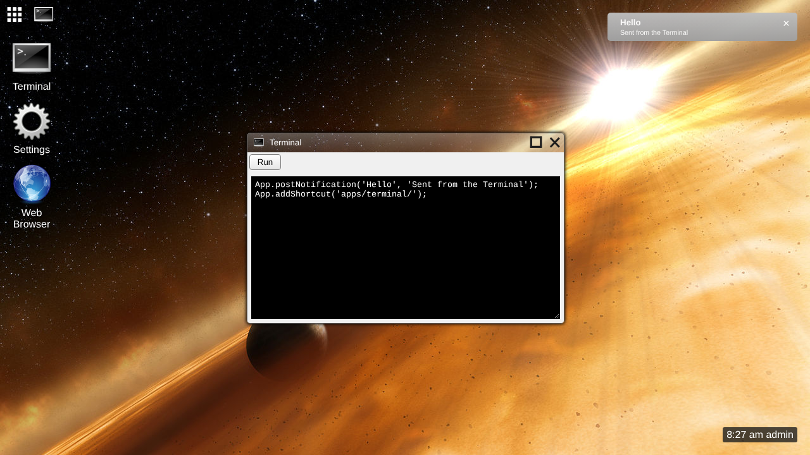

# Skylight OS as a CouchDB 2.3.1 couchapp

This is Skylight OS running entirely inside **Apache CouchDB 2.3.1**, as a *couchapp*: the web pages are attachments of a CouchDB design document, and CouchDB itself is the server. There's no PHP and no web server. The code is in [`../site9couchdb`](../site9couchdb).

The pages are the browser version's ([`../site3`](../site3), documented in [`../wiki3`](../wiki3/README.md)): the same desktop, windows, apps and App API, in plain ES5 JavaScript. What changed is everything behind them:

| site3 (PHP) | site9couchdb (CouchDB) |
| --- | --- |
| `api/login.php`, `api/logout.php` | CouchDB's `/_session` (cookie login) |
| `data/users.json`, `tools/add-user.php` | CouchDB's `_users` database, `tools/add-user` |
| `data/users/<name>/settings.json` | A `settings` document in the user's own database |
| `data/users/<name>/files/<file>` | A `file:<file>` document in the user's own database |
| PHP checks on every save | `validate_doc_update` functions run by CouchDB |
| Files under `public/`, served by the web server | Attachments of `_design/skylight`, served by CouchDB |

Each user's database (`userdb-<name in hex>`) is created by CouchDB's **couch_peruser** feature and can only be read by that user.

## Contents

**Using Skylight OS**

* [Getting started](getting-started.md): install CouchDB, push the couchapp, add users
* [User guide](user-guide.md): the desktop, windows, notifications and the built-in apps

**Building apps**

* [Building your first app](building-apps.md): a step-by-step tutorial
* [App manifest](app-manifest.md): the `app.json` file
* [App API](app-api.md): the `App` object apps use
* [UI components](ui-components.md): the shared styles

**How it works**

* [Architecture](architecture.md): the browser, the design document and the databases
* [CouchDB primer](couchdb-primer.md): the CouchDB features Skylight uses
* [Desktop internals](desktop-internals.md): what changed from the PHP version, and `core.js`
* [Data and configuration](data-and-configuration.md): documents, databases, tools and settings

**Background**

* [Compared with the other versions](comparison.md)
* [Security](security.md)
* [Limitations](limitations.md)

## At a glance

| | |
| --- | --- |
| Runs on | Apache CouchDB 2.3.1 (2.x in general); any modern browser |
| Languages | ES5 JavaScript, HTML and CSS; JavaScript `validate_doc_update` functions in CouchDB |
| Server code | None: three validation functions and two rewrite rules |
| Install tools | `tools/push.sh` and `tools/add-user.sh` (bash and curl), or `tools\push.ps1` and `tools\add-user.ps1` (PowerShell) |
| Data | CouchDB documents, one private database per user |
| Tested | On a CouchDB 2.3.1 built from Apache's source release, with Chromium (see [Limitations](limitations.md#how-it-was-tested)) |
